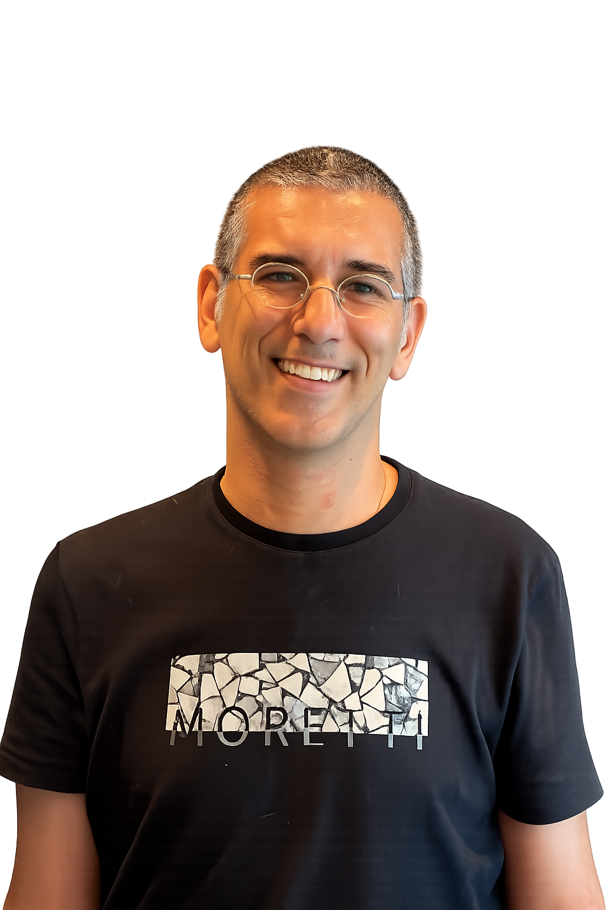

# Hi, I'm Dekel 👋

You might know me as **Tovli**. I build software, help engineering teams grow, and explore how AI can solve useful problems. My work connects architecture, people, and the purpose behind what we're building.

Today I'm a **technical partner at [Cognitum](https://cognitum.one)** and **co-founder & CTO at [Mall Shop Link](https://www.mallshoplink.com)**. My background includes engineering leadership at Transmit Security, eToro, and CyberArk, spanning cybersecurity, fintech, and complex product systems.

 

### What I'm building

| Project | What I'm exploring |
| --- | --- |
| [EdgeIntelligence](https://github.com/Tovli/EdgeIntelligence) | On-device language models, privacy, offline inference, and constrained hardware. Built with Rust. |
| [Agentics Patterns](https://github.com/Tovli/agentics-patterns) | Runnable agent workflows with clear contracts and evaluation, so you can inspect how they work. |
| [engineeringMemory](https://github.com/Tovli/engineeringMemory) | A local-first technical memory assistant for engineering documents, with local embeddings and hybrid search. Built with Rust. |
| [Living Positively / מצילון](https://github.com/ClubhouseAmit/LivingPositively) | A Flutter app for mental well-being, personal planning, gratitude journaling, and wellness resources. |
| [HearO](https://github.com/Hear-o/Hearo) | A volunteer-built app for veterans, exploring user-controlled sound practice with gentle, pulse-responsive adjustments. |

### How I work

- **Look at the whole system.** Code, incentives, feedback loops, and delivery all shape the outcome.
- **Give people ownership.** Help engineers and managers build judgment, with the context to make decisions.
- **Keep building.** Test ideas hands-on and let real constraints challenge the architecture.

### Beyond the code

I write and speak about engineering leadership, systems thinking, and practical AI. I also co-host two Hebrew AI podcasts with **Shiron Babi**:

- [מעבר למודל · Beyond the Model](https://open.spotify.com/show/2OLTpyueb1KssnUkj43Pqw) — architecture, security, validation, and the choices behind practical AI.
- [לפרק את הבאז · Unpacking the Buzz](https://open.spotify.com/show/2yb1Eguq3pW1BQUkYPVBNL) — AI news and what it means for people building with it.

I volunteer in technology leadership with **Clubhouse / מצילון**, supporting mental well-being, and lead a volunteer team working on [Hearo](https://hearo-rho.vercel.app).

### Let's connect

Happy to talk about system design, engineering leadership, practical AI, open source, or a project with human impact.

[Website](https://me.tovli.co.il) · [LinkedIn](https://www.linkedin.com/in/dekelasaf/) · [Writing](https://www.linkedin.com/in/dekelasaf/recent-activity/all/) · [Speaking & media kit](https://me.tovli.co.il/media-kit/)
